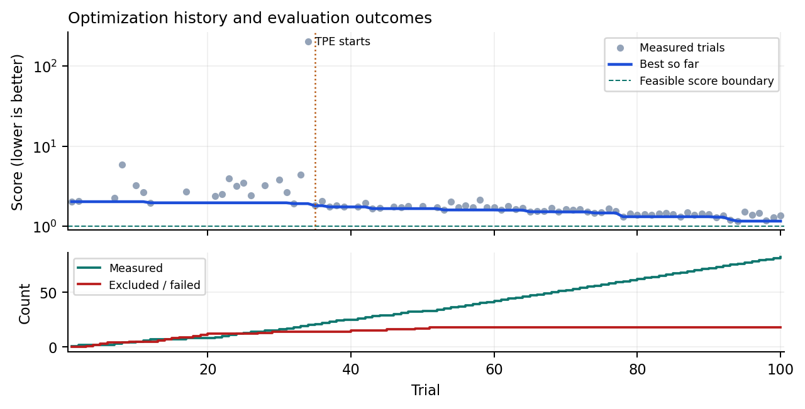
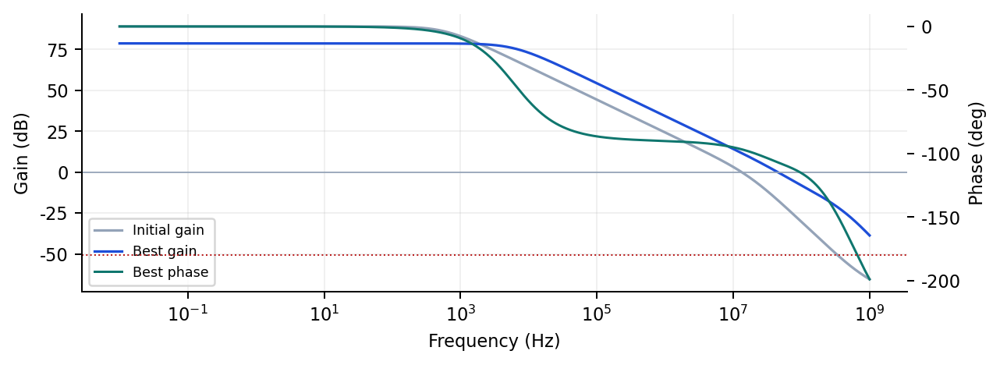

# Optuna 기반 OP-Amp 스펙 최적화

개인 프로젝트 · Python · Optuna TPE · LTspice

PMOS 입력 2단 OP-Amp의 MOS 폭과 보상 소자 Rz·Cc를 탐색하고, LTspice 측정 결과로 다음 후보를 선택하는 최적화 프로그램입니다. Optuna의 `TPESampler`를 사용하며, 초기 탐색 이후 이전 평가 결과를 반영해 후보를 제안합니다.

[결과보고서 PDF](results/Optuna%20Op-Amp%20Optimization.pdf) · [최적화 코드](optimizer.py) · [평가·측정 코드](circuit_engine.py) · [최선 후보 회로도](results/best_candidate.asc)

## 설계와 평가

| 항목 | 내용 |
|---|---|
| 회로 | PMOS 입력 2단 OP-Amp, MOS 10개, Rz·Cc 보상 |
| 조건 | 전원 3.3 V, L=1 µm, 부하 10 pF, TT·25°C |
| 탐색 변수 | W1=W2와 W5~W10의 폭 7개, Rz, Cc |
| DC 균형 | 각 후보의 W3=W4를 별도 조정해 출력 DC 전압을 1.65 V에 맞춤 |
| 평가 | 전력, 이득, UGF, 위상여유, 대역폭, 양방향 slew rate, ICMR·OCMR, 포화 여유, 정착 여부 |
| 점수 | 조건 위반에 대한 패널티를 우선 평가하고, 모든 조건을 통과하면 FoM으로 비교 |
| 기록 | 시행별 측정값·실패 사유, JSON·CSV, Optuna SQLite, 최선 회로도, PDF 보고서 |

## 저장된 100회 탐색 결과

총 100회 중 82회가 정상 측정되었고, 18회는 제외 또는 실패했습니다. 전체 수치 검사를 통과한 후보는 0개이며, 최선 후보는 94번째 시행입니다.

| 최선 후보 측정값 | 결과 |
|---|---:|
| DC 이득 | 78.59 dB |
| Unity-gain 주파수 | 44.96 MHz |
| 위상여유 추정값 | 73.05° |
| 소비전력 | 3.567 mW |
| Slew rate 상승 / 하강 | 37.40 / 116.24 V/µs |
| 개방루프 −3 dB 대역폭 | 6.065 kHz — 목표 10 kHz 미달 |
| 최소 MOS 포화 여유 | −0.027 V — 포화 조건 미달 |





원본 보고서와 [측정 데이터](results/data/)를 함께 제공합니다. 위상여유는 단위 음귀환을 가정한 추정값이며, 입력·출력 범위는 0.05 V 간격의 검사입니다. 이 결과는 TT 조건의 탐색 기록이며 전체 목표 달성이나 PVT·불일치 검증 완료를 의미하지 않습니다.

## 코드 구성

| 파일 | 역할 |
|---|---|
| [optimizer.py](optimizer.py) | TPE 후보 생성, 평가 호출, 최선 후보와 시행 이력 저장 |
| [circuit_engine.py](circuit_engine.py) | LTspice 배치 실행, DC 균형 조정, 성능 평가와 조건 판정 |
| [measure_baseline.py](measure_baseline.py) | RAW 데이터 판독과 AC 성능 추출 |
| [live_dashboard.py](live_dashboard.py) | 진행 상황과 결과를 보여 주는 데스크톱 UI |
| [report_generator.py](report_generator.py) | 저장된 실행 결과를 PDF 보고서로 정리 |
| [targets.json](targets.json) | 목표 스펙과 측정 조건 |

코드는 로컬에 보관된 현재 버전이며, 위 보고서는 이전에 완료한 100회 실행의 기록입니다. 현재 코드에는 이후 추가된 실행 제어 기능이 포함되어 있습니다. [파일 출처와 해시](provenance.json)에 공개본과 원본의 대응 관계를 기록했습니다.

## 실행 환경

Windows, Python, LTspice와 별도로 보유한 공정 모델이 필요합니다. 공정 모델 원본은 포함하지 않았습니다. `models/1533IL11SK_Rev3p0.l`에 모델과 상대 경로로 참조되는 파일들을 준비하거나, `two_stage_cmos_3v3_pdk.asc`의 `.lib` 경로를 본인 환경에 맞게 수정합니다. `measure_baseline.py`의 `DEFAULT_EXE`도 LTspice 설치 경로와 일치해야 합니다.

```powershell
python -m pip install -r requirements.txt
python live_dashboard.py
```

대시보드를 열고 시행 횟수와 초기 탐색 수를 지정한 뒤 시작합니다. 아래 명령은 100회 최적화를 실제로 실행합니다.

```powershell
python optimizer.py --mode fixed --trials 100 --startup 20
```

측정 함수, 실행 제어와 보고서 처리에 대한 기존 검사는 LTspice를 실행하지 않는 모의 평가기를 사용합니다.

```powershell
python -m unittest -v test_measurements test_run_modes test_reports
```
