# 4×4 CMOS Image Sensor

5bit 파이프라인 ADC와 80bit SRAM을 연결한 이미지 센서 회로입니다.

[PDF 보고서 · 결론까지 44쪽](5-bit%20CMOS%20Image%20Sensor.pdf)

## 설계 개요

4×4 Pixel Array의 아날로그 신호를 5bit 코드로 변환하고, 80bit SRAM에 저장한 뒤 픽셀 순서로 출력하는 회로를 설계하였다. 두 채널의 3bit+2bit Pipeline ADC와 다섯 개의 출력 Flip-Flop을 연결해 Pixel부터 최종 Q4~Q0까지의 동작을 확인하였다.

회로는 16개의 픽셀을 사용한다. 32개 입력 전압 수준을 모두 시험하기 위해 입력을 LOW와 HIGH 두 버전으로 나누었다. LOW에는 0.96~1.56 V, HIGH에는 1.60~2.20 V를 각각 0.04 V 간격으로 인가하였다. 두 버전은 같은 코어를 사용하며 픽셀 입력만 다르다.

LOW와 HIGH 각각에서 16개 ADC 코드, 8회 SRAM 쓰기, 16회 최종 읽기 및 80개 저장 노드의 유지가 확인되었다.

| 항목 | 설계 내용 |
| --- | --- |
| Pixel | 4×4 배열 16개, 홀수열·짝수열 두 경로 |
| ADC | 2채널, 각 3bit Flash + MDAC ×8 + 2bit Flash |
| Memory | 8행 × 10bit = 80bit SRAM |
| Output | 5개의 1.5 V DFF, Q4 Q3 Q2 Q1 Q0 |
| Supply / Clock | vdda 3.3 V, vddd 1.5 V, 외부 20 MHz |
| 시험 조건 | TT, 27 °C, LOW/HIGH 각 34 μs |

32개 이산 입력점에 대한 기능 검증이며, 연속 입력의 DNL·INL 또는 PVT 성능을 검증한 결과는 아니다.

## 회로 구성

전체 회로 구성

PIXELS에서 선택한 두 픽셀의 신호를 CDS_odd와 CDS_even에 전달한다. 각 ADC가 생성한 5bit 코드를 전압 변환 회로를 거쳐 SRAM 한 행에 함께 저장한다. 저장을 마친 뒤 한 번에 5bit씩 읽어 Output Register로 보낸다.

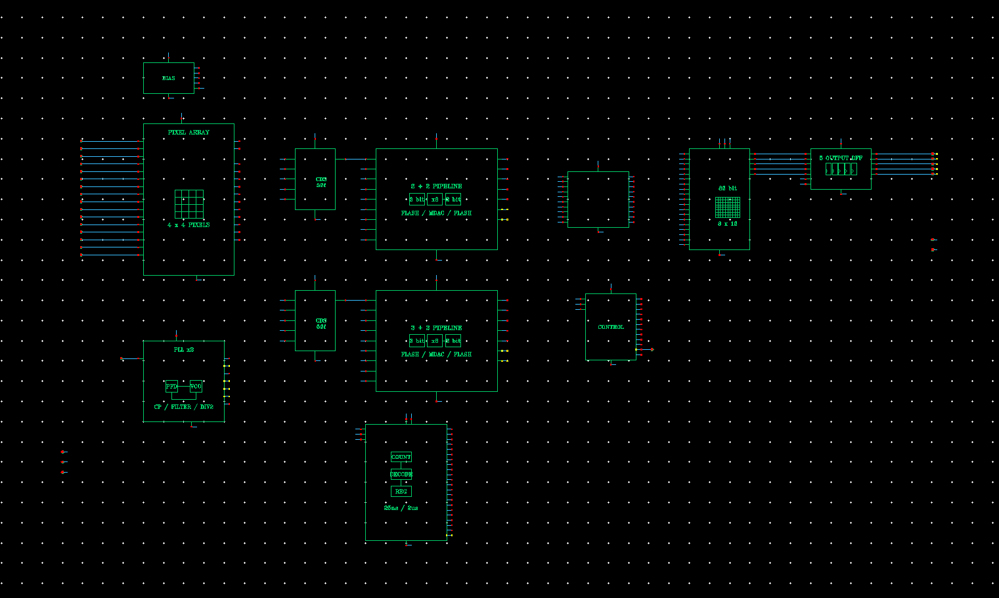

전체 코어 Schematic

BIAS는 Source Follower, Common Mode, ADC 기준 및 SRAM Precharge 전압을 공급한다. PLL과 TIMING, MEM_CONTROL은 초기화, 픽셀 선택, ADC 변환, SRAM 저장 및 순차 읽기를 제어한다.

신호 변환부와 메모리 연결

전체 회로의 앞단과 메모리 부분을 확대하였다. 두 채널은 같은 회로를 사용하며 odd/even이라는 이름으로 구분된다. 동일한 이름의 네트 라벨은 배선이 화면에서 떨어져 있어도 전기적으로 연결되어 있다.

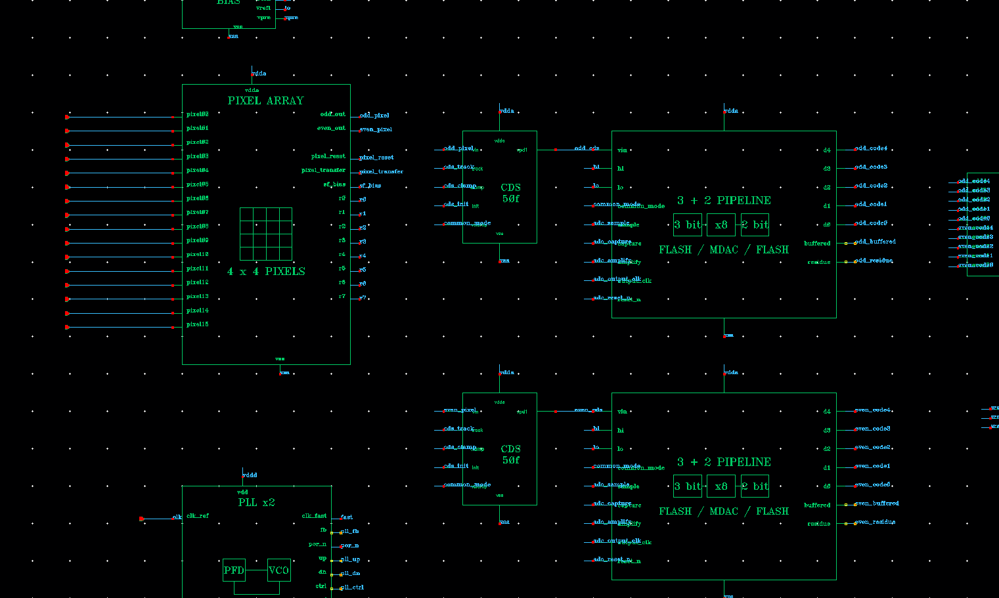

Pixel 및 두 CDS ADC 경로 확대

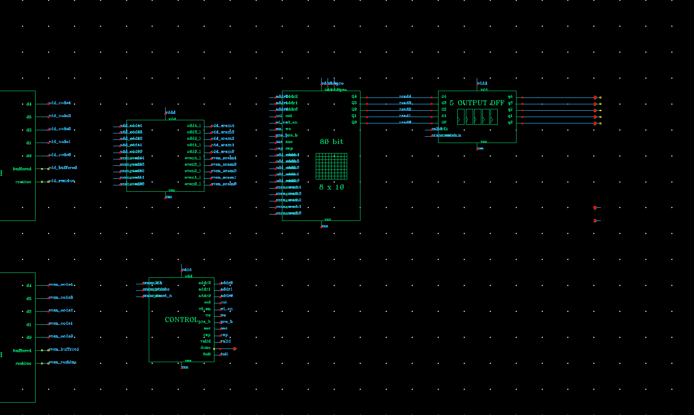

전압 변환 SRAM Output Register 연결 확대

4T Pixel

Reset으로 감지 노드를 초기화한 뒤 Transfer 동작으로 입력에 따른 신호를 전달한다. Source Follower와 Select 소자를 통해 선택한 픽셀의 신호가 열 출력으로 전달된다. 기존 픽셀 연결과 소자 크기를 유지하였으며 FD 커패시터를 추가하지 않았다.

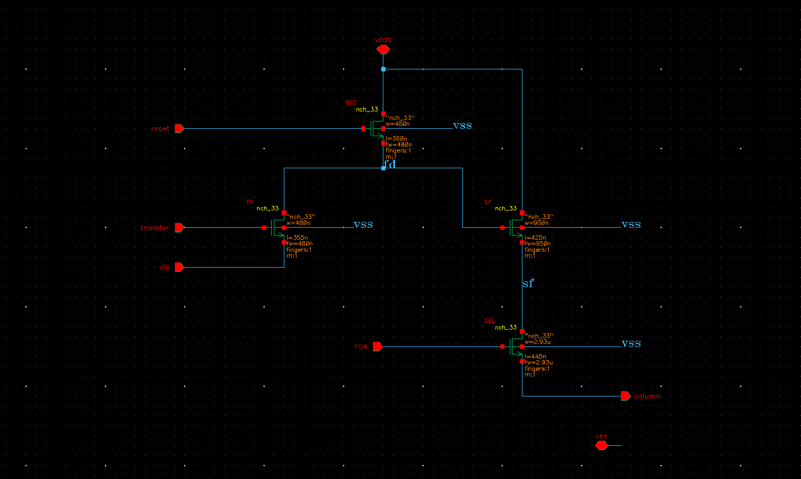

4T Pixel Schematic  |  SYS_PIXEL4T_261108

| 소자 | W | L |
| --- | --- | --- |
| Reset | 480 nm | 360 nm |
| Transfer | 480 nm | 355 nm |
| Source Follower | 950 nm | 425 nm |
| Select | 2.93 μm | 445 nm |

입력과 제어 포트를 해당 소자 옆에 배치하고, Reset–FD–Source Follower–Select의 신호 경로를 연속 배선으로 정리하였다. 소자의 크기와 전기적 연결은 기존 검증본과 같다.

4×4 Pixel Array

16개 픽셀을 두 열 경로로 읽는다. r0~r7은 8개의 픽셀 쌍을 순서대로 선택하는 신호이며, 물리적인 4개 행 이름과 구분한다. 한 쌍에서 pixel(2j)는 odd 경로, pixel(2j+1)는 even 경로로 전달된다.

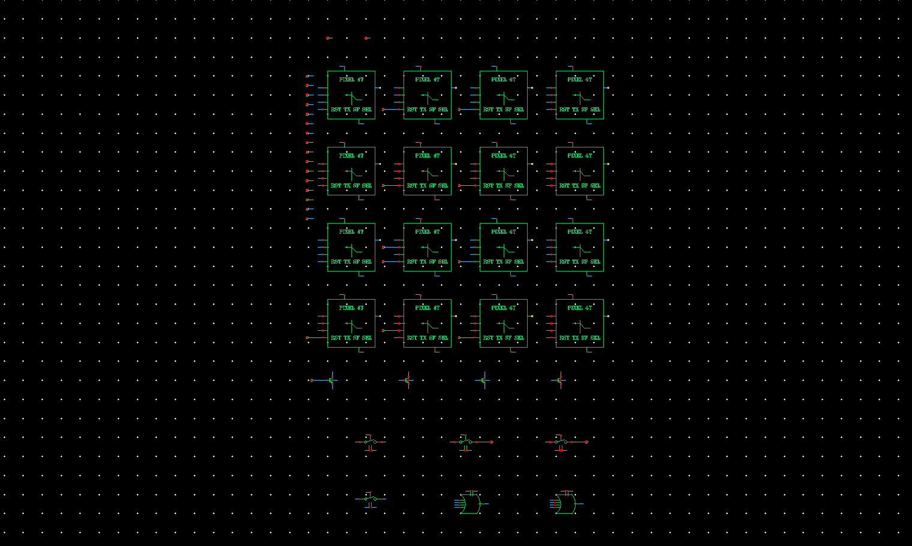

4×4 Pixel Array 전체 Schematic

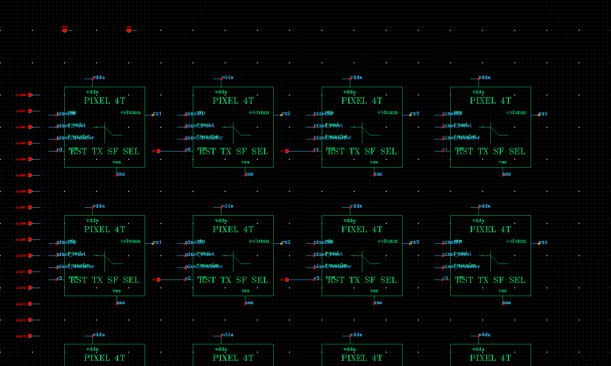

배열 상단의 픽셀 연결 확대

CDS 회로

Track과 Clamp 스위치로 Reset 기준을 저장하고, 이후 Signal의 변화를 샘플링 커패시터에 반영한다. 두 채널 모두 같은 CDS 회로를 사용한다. 50 fF는 CDS 샘플링 커패시터이며 픽셀의 FD에 추가한 커패시터가 아니다.

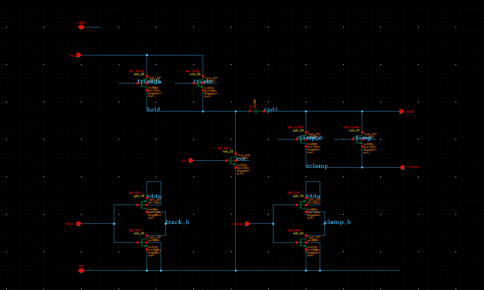

CDS Schematic  |  HWS_CDS

CDS 출력은 버퍼를 거쳐 ADC에 전달된다. 최종 코드의 판단에는 실제 픽셀, CDS 및 ADC 부하가 연결된 전체 회로의 결과를 사용하였다.

Pixel 및 CDS Simulation

LOW 첫 쌍의 입력은 0.96 / 1.00 V이며, HIGH 마지막 쌍은 2.16 / 2.20 V이다. Reset과 Transfer에 따른 Pixel 및 CDS 출력을 같은 전압 축 범위로 비교하였다.

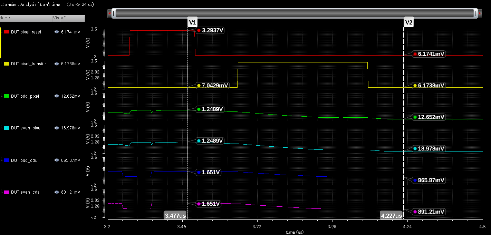

LOW 첫 쌍  |  V1 3.477 μs  V2 4.227 μs

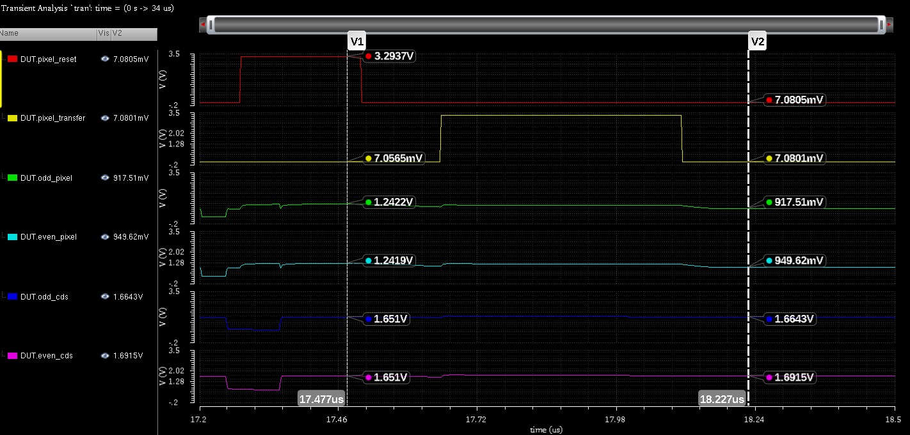

HIGH 마지막 쌍  |  V1 17.477 μs  V2 18.227 μs

V1은 Reset 구간, V2는 ADC coarse capture 부근이다. 그림의 V 마커는 실제 ViVA 측정 기능이며, 표의 전압은 각 시각의 vss를 뺀 값이다.

LOW Pixel 측정 결과

LOW 프레임의 16개 입력에 대한 Pixel과 CDS 전압이다. 각 픽셀 쌍 j의 Reset은 3.477+2j μs, Signal과 CDS는 4.227+2j μs에서 읽었다. 모든 값은 해당 시각의 vss 기준이다.

| Pixel | 입력 V | Reset V | Signal V | CDS V |
| --- | --- | --- | --- | --- |
| 00 | 0.96 | 1.24184 | 0.00648 | 0.85971 |
| 01 | 1.00 | 1.24184 | 0.01281 | 0.88504 |
| 02 | 1.04 | 1.23965 | 0.02705 | 0.91225 |
| 03 | 1.08 | 1.23963 | 0.04595 | 0.93790 |
| 04 | 1.12 | 1.23958 | 0.06652 | 0.96347 |
| 05 | 1.16 | 1.23956 | 0.09265 | 0.98931 |
| 06 | 1.20 | 1.23917 | 0.11464 | 1.01575 |
| 07 | 1.24 | 1.23913 | 0.14490 | 1.04172 |
| 08 | 1.28 | 1.23945 | 0.18244 | 1.06723 |
| 09 | 1.32 | 1.23942 | 0.21059 | 1.09337 |
| 10 | 1.36 | 1.23907 | 0.24183 | 1.12001 |
| 11 | 1.40 | 1.23902 | 0.27152 | 1.14632 |
| 12 | 1.44 | 1.23905 | 0.30253 | 1.17229 |
| 13 | 1.48 | 1.23899 | 0.33401 | 1.19871 |
| 14 | 1.52 | 1.23881 | 0.36009 | 1.22530 |
| 15 | 1.56 | 1.23873 | 0.39399 | 1.25188 |

Reset−Signal의 변화는 CDS에서 공통 모드 전압과 함께 처리된다. 입력 전압원 값과 ADC에 실제로 전달되는 CDS 전압은 서로 다른 값이다.

HIGH Pixel 측정 결과

HIGH 프레임의 16개 입력에 대한 Pixel과 CDS 전압이다. 각 픽셀 쌍 j의 Reset은 3.477+2j μs, Signal과 CDS는 4.227+2j μs에서 읽었다. 모든 값은 해당 시각의 vss 기준이다.

| Pixel | 입력 V | Reset V | Signal V | CDS V |
| --- | --- | --- | --- | --- |
| 00 | 1.60 | 1.24184 | 0.42787 | 1.27569 |
| 01 | 1.64 | 1.24184 | 0.46021 | 1.30232 |
| 02 | 1.68 | 1.23895 | 0.49364 | 1.33169 |
| 03 | 1.72 | 1.23881 | 0.52782 | 1.35851 |
| 04 | 1.76 | 1.23859 | 0.56000 | 1.38526 |
| 05 | 1.80 | 1.23841 | 0.59424 | 1.41218 |
| 06 | 1.84 | 1.23818 | 0.62964 | 1.43933 |
| 07 | 1.88 | 1.23798 | 0.66508 | 1.46635 |
| 08 | 1.92 | 1.23816 | 0.70109 | 1.49274 |
| 09 | 1.96 | 1.23787 | 0.73814 | 1.51989 |
| 10 | 2.00 | 1.23719 | 0.77527 | 1.54757 |
| 11 | 2.04 | 1.23677 | 0.81102 | 1.57485 |
| 12 | 2.08 | 1.23662 | 0.84527 | 1.60159 |
| 13 | 2.12 | 1.23596 | 0.87802 | 1.62918 |
| 14 | 2.16 | 1.23512 | 0.91043 | 1.65720 |
| 15 | 2.20 | 1.23488 | 0.94253 | 1.68443 |

Reset−Signal의 변화는 CDS에서 공통 모드 전압과 함께 처리된다. 입력 전압원 값과 ADC에 실제로 전달되는 CDS 전압은 서로 다른 값이다.

5bit Pipeline ADC

첫 번째 Flash는 일곱 개의 비교기로 입력 구간을 나누고 상위 3bit를 결정한다. MDAC가 이 코드에 해당하는 기준 전압을 빼고 잔차를 8배 확대한다. 두 번째 Flash는 잔차를 2bit로 변환한다.

상위 3bit와 하위 2bit를 정렬 레지스터에서 함께 저장하여 d4~d0를 출력한다. 두 ADC 채널에는 실제 트랜지스터 비교기가 총 20개 사용된다.

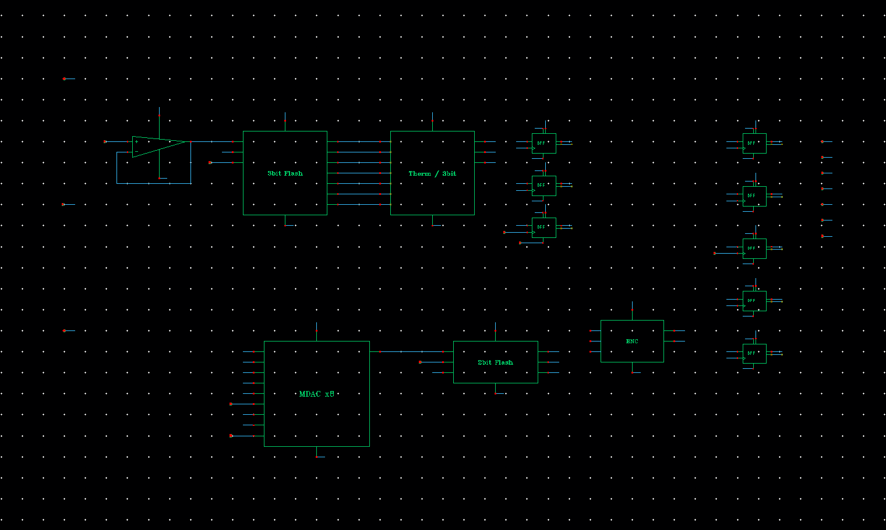

5bit ADC 전체 Schematic

코드 조합은 D = 4 × Dcoarse + Dfine이다. 비교기 출력과 저장된 잔차가 실제 비트 결정에 사용된다.

첫 번째 Flash와 Encoder

hi와 lo 사이의 저항 사다리가 여덟 구간의 기준을 만든다. 일곱 비교기의 Thermometer 출력을 Encoder가 3bit로 변환하고, coarse capture 신호로 레지스터에 저장한다.

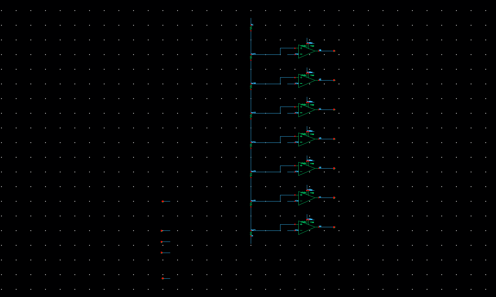

3bit Flash Schematic

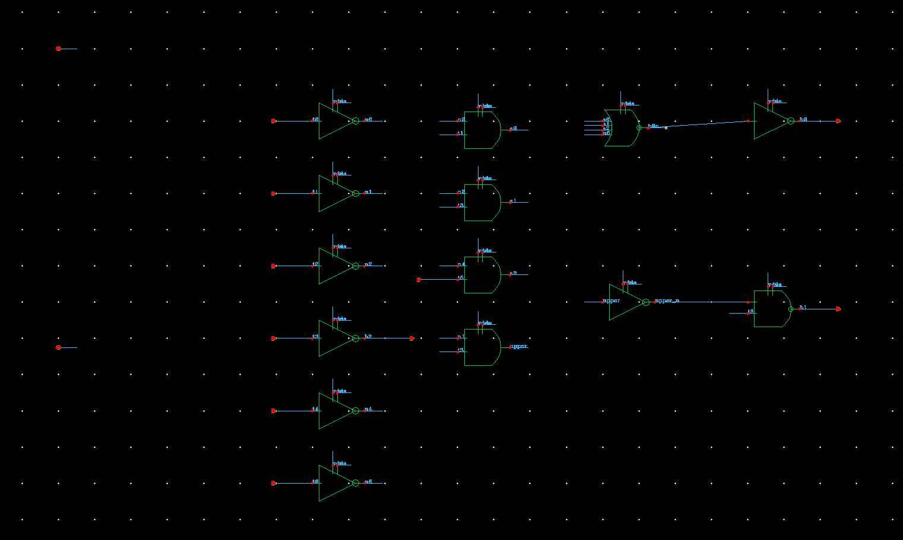

Thermometer to Binary Encoder

이상적인 경계는 Vlo + k(Vhi−Vlo)/8, k=1~7이다. 실제 동작은 부하가 연결된 기준 전압과 비교기의 응답을 포함한다.

Coarse 경로와 출력 정렬

버퍼, 첫 번째 Flash, Encoder와 상위 3bit 레지스터의 연결을 확대하였다. 오른쪽 출력 레지스터는 coarse 결과와 fine 결과를 동일한 output_clk에서 저장한다.

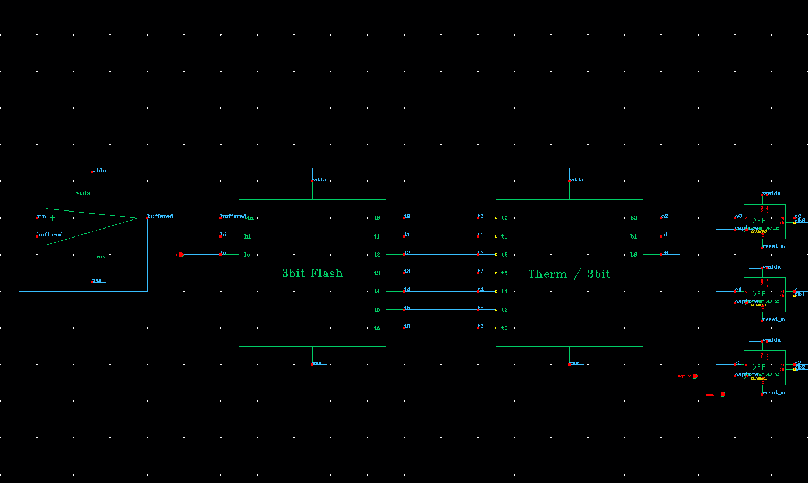

ADC 상단의 Coarse 경로 확대

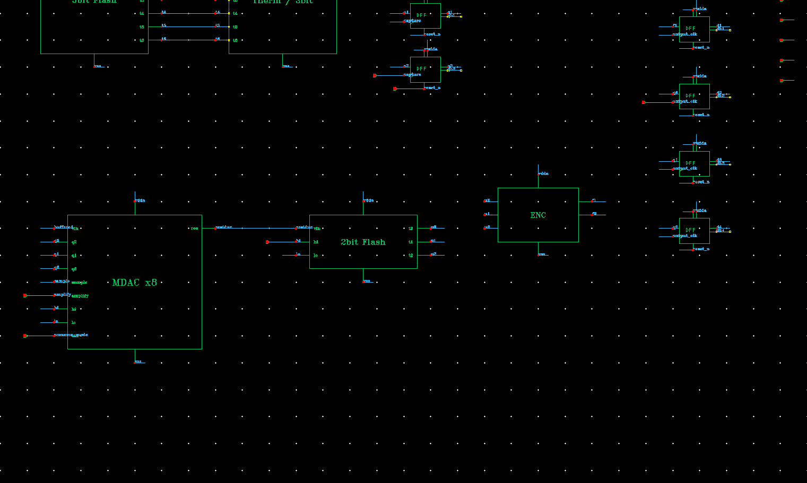

ADC 하단의 MDAC 및 Fine 경로 확대

MDAC

Sample 구간에는 입력 전압을 저장하고, Amplify 구간에는 상위 3bit에 따라 각 커패시터의 기준 연결을 바꾼다. 피드백 커패시터 CF와 입력 커패시터의 비율로 잔차 이득 8을 만든다.

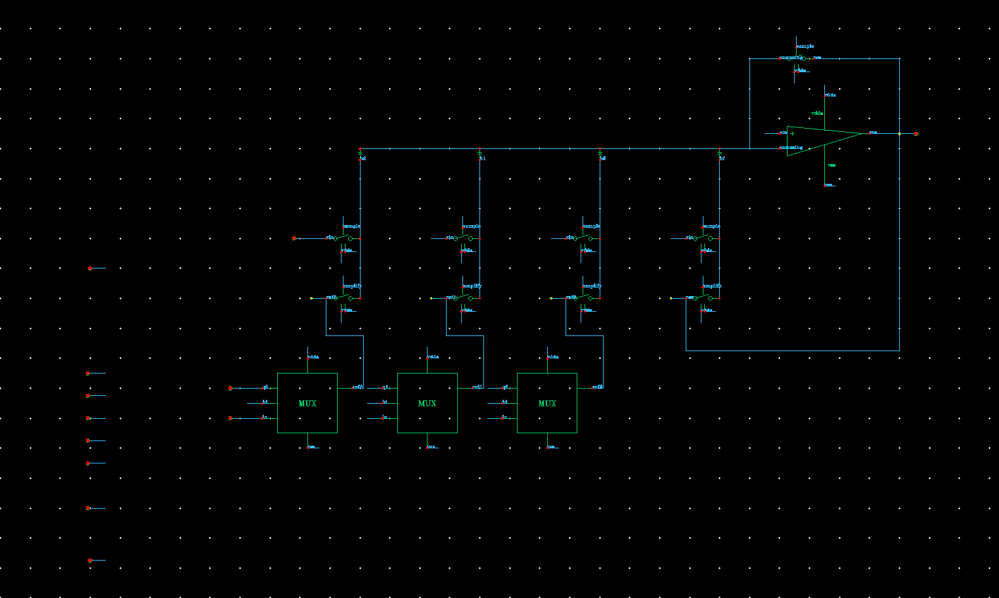

MDAC Schematic

| 항목 | 값 | 비율 |
| --- | --- | --- |
| C2 | 2 pF | 4 |
| C1 | 1 pF | 2 |
| C0 | 0.5 pF | 1 |
| CF | 0.5 pF | 1 |

이상적인 전하 보존 관계는 Vres ≈ 8Vin − 7Vlo − Dcoarse(Vhi−Vlo)이다. 실제 잔차에는 증폭기 정착, 스위치 및 기준 전압의 부하 효과가 포함된다.

증폭기와 비교기

버퍼와 MDAC에는 트랜지스터 증폭기를 사용하며, Flash에는 실제 트랜지스터 비교기를 사용한다. 아래 화면은 상위 Symbol에 대응하는 하위 Schematic이다.

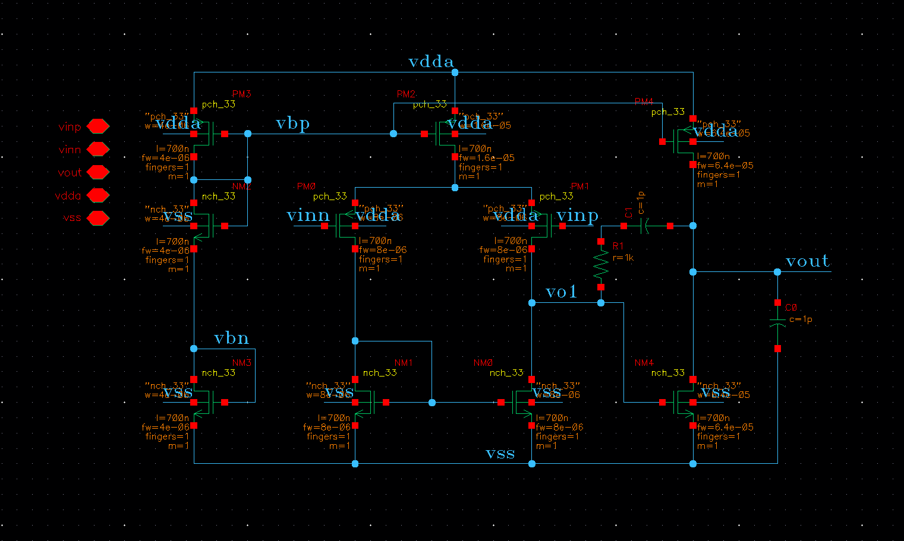

증폭기 Schematic  |  HWS_PIPE4_AMP_261106

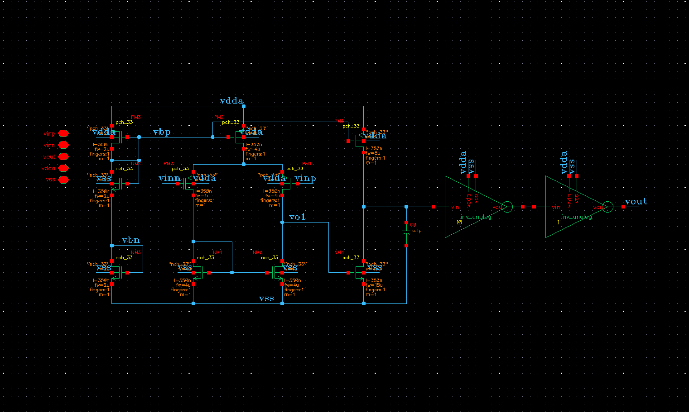

비교기 Schematic  |  HWS_comparator

본 보고서의 기능 파형은 이 회로들이 포함된 결과이다. 증폭기의 별도 주파수 응답이나 비교기의 Noise·Offset 분포를 측정한 것은 아니다.

두 번째 Flash

MDAC 잔차를 세 개의 비교기로 판정해 하위 2bit를 얻는다. 상위 3bit가 저장된 상태에서 잔차가 정착한 후 최종 출력 레지스터가 두 단계의 결과를 함께 받아들인다.

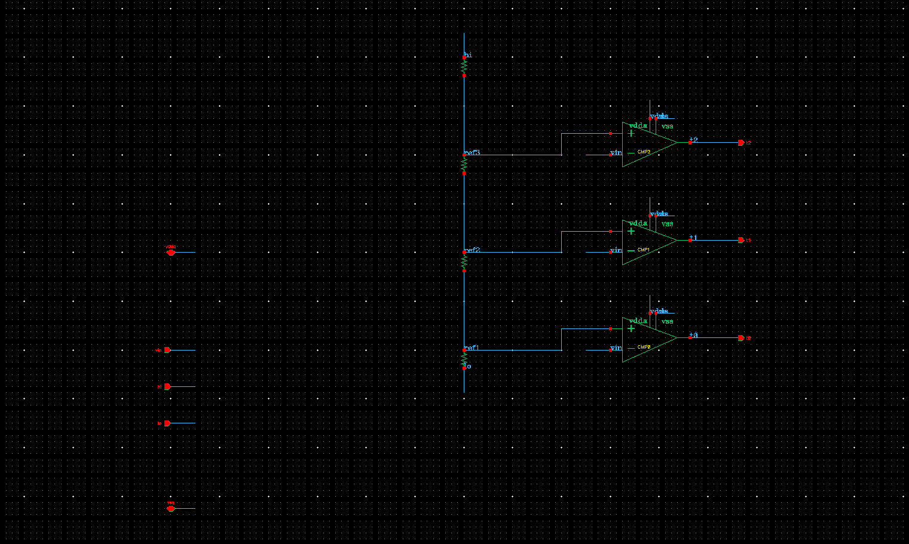

2bit Flash Schematic

첫 단계는 입력 범위를 8구간으로, 두 번째 단계는 각 구간을 다시 4구간으로 나누므로 전체 32개 코드가 구성된다. 이 구조는 3bit+2bit Pipeline ADC이다.

MDAC 및 ADC 제어 파형

LOW의 처음 두 픽셀 쌍에서 Sample과 Amplify가 겹치지 않는지, 버퍼 출력과 잔차가 각 변환 구간에 대응하는지 확인하였다. V1과 V2는 각 쌍의 Amplify 후반부를 나타낸다.

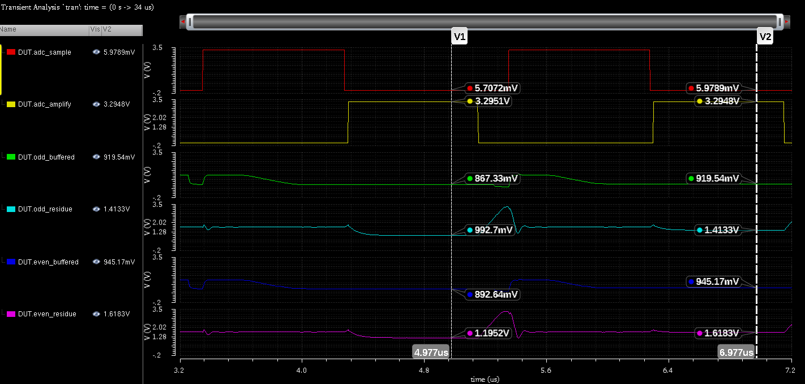

LOW MDAC 파형  |  V1 4.977 μs  V2 6.977 μs

최종 비트 검사는 output_clk 상승 후 20 ns에서 수행하였다. 위 마커는 잔차의 정착 상태를 보기 위한 시각이며, 코드 판독 시각과 구분한다.

LOW ADC Simulation

LOW에서 odd 채널은 코드 0, 2, …, 14, even 채널은 1, 3, …, 15를 출력한다. 두 파형의 시간축과 전압축 범위를 같게 맞추었다.

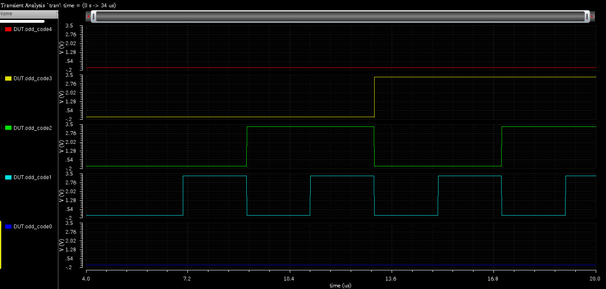

LOW odd ADC 출력  |  code4~code0

LOW even ADC 출력  |  code4~code0

ADC 출력의 논리 High는 약 3.3 V이다. 첫 output_clk 상승은 약 5.051 μs이며 이후 약 2 μs 간격으로 다음 픽셀 쌍의 코드가 저장된다.

HIGH ADC Simulation

HIGH에서 odd 채널은 코드 16, 18, …, 30, even 채널은 17, 19, …, 31를 출력한다. 두 파형의 시간축과 전압축 범위를 같게 맞추었다.

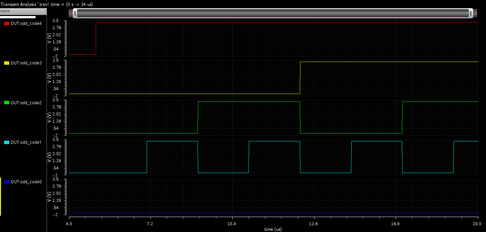

HIGH odd ADC 출력  |  code4~code0

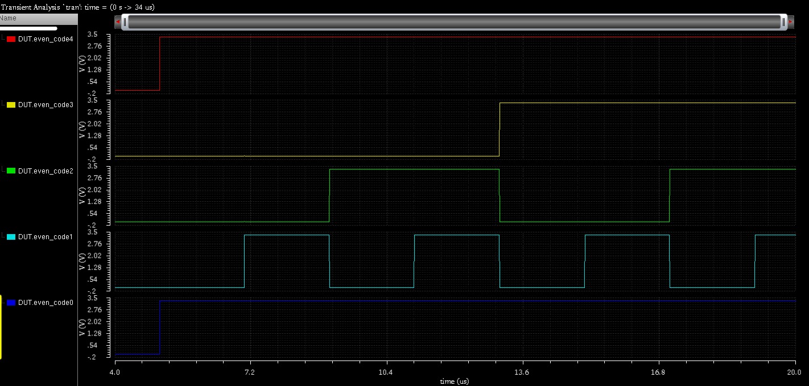

HIGH even ADC 출력  |  code4~code0

ADC 출력의 논리 High는 약 3.3 V이다. 첫 output_clk 상승은 약 5.051 μs이며 이후 약 2 μs 간격으로 다음 픽셀 쌍의 코드가 저장된다.

ADC와 SRAM의 전압 변환

두 ADC의 3.3 V 출력을 1.5 V SRAM 데이터 입력에 맞춘다. 홀수열과 짝수열의 5bit씩, 총 10bit를 동시에 전달하므로 한 번의 Write에 두 픽셀의 코드가 저장된다.

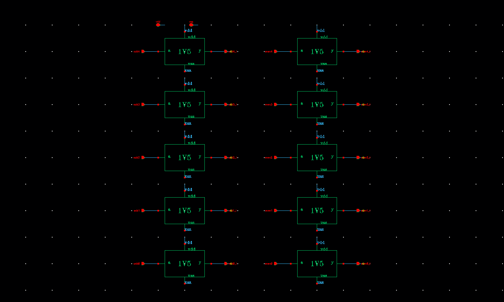

10bit 전압 변환 Schematic

ADC 코드와 SRAM 입력의 전압 크기는 다르지만 논리 값의 순서는 유지된다. 최종 Q 출력은 SRAM을 읽은 뒤 별도의 1.5 V DFF에서 나온다.

6T SRAM Cell과 Write Driver

교차 결합된 두 Inverter가 1bit를 저장하며, 두 접근 NMOS가 WL에 따라 BL과 BLB를 저장 노드에 연결한다. Write Driver는 데이터와 반전 데이터를 차동 Bit Line에 전달한다.

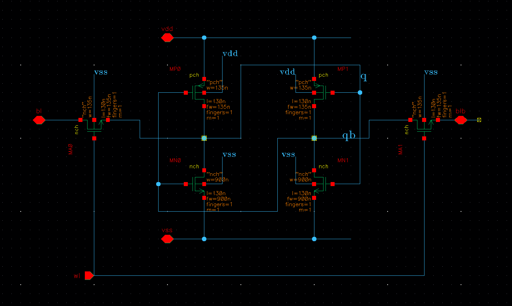

6T SRAM Cell Schematic

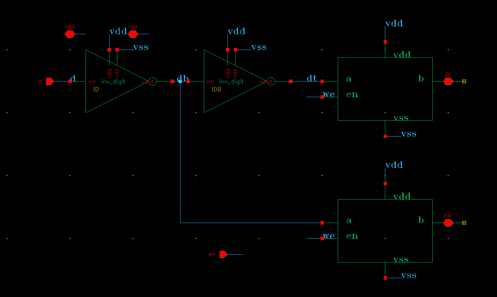

Write Driver Schematic

저장 코어는 1.5 V 소자를 사용하고 WL은 3.3 V로 구동한다. 기존 nch 접근 소자의 게이트 스트레스에 대한 신뢰성 검증은 별도로 완료되지 않았다.

Precharge 및 Sense 회로

Read 전에 BL과 BLB를 vpre 부근으로 Precharge한다. 이후 WL을 선택하고 저장 데이터에 따라 발생한 Bit Line 차이를 Sense 회로가 판별한다. Precharge와 Write가 동시에 켜지지 않도록 제어한다.

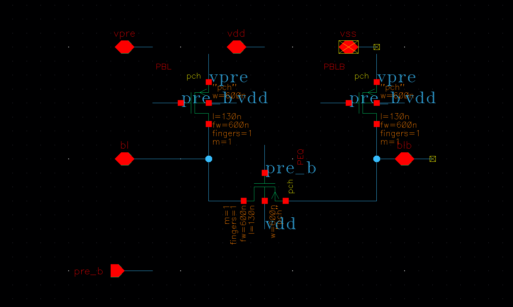

Precharge Schematic

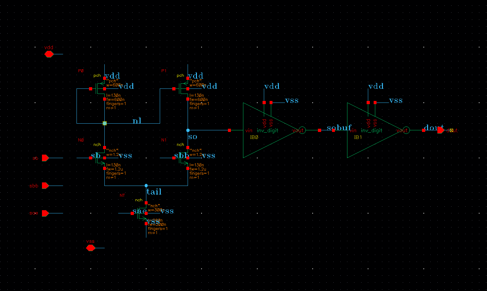

Sense Schematic

80bit SRAM

8행×10열에 80개의 6T Cell을 배치하였다. 행 j에는 odd의 5bit와 even의 5bit를 함께 저장한다. Read MUX는 두 5bit 그룹 중 하나를 선택하여 다섯 개의 read 신호로 전달한다.

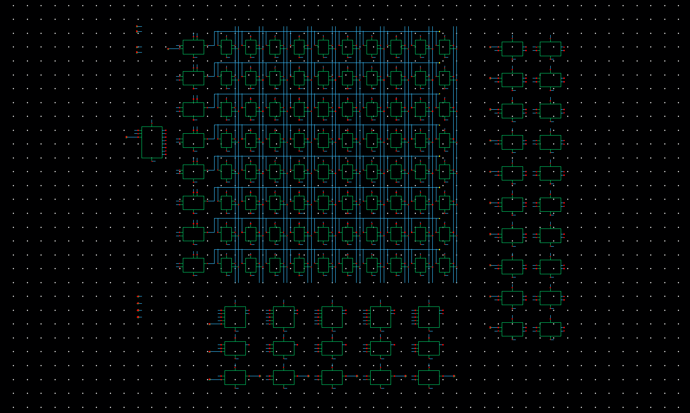

80bit SRAM Schematic

한 프레임의 저장량은 16픽셀×5bit=80bit이다. 8회 Write가 끝난 후 16회 Read를 수행하므로 읽기 전 전체 프레임이 저장되어 있다.

SRAM 주소 및 제어 회로

주소 Counter와 Decoder가 8개 행을 선택한다. MEM_CONTROL은 쓰기 완료를 full로 표시한 뒤 순차 읽기를 시작한다. col 선택으로 한 행의 두 5bit 단어를 차례로 읽는다.

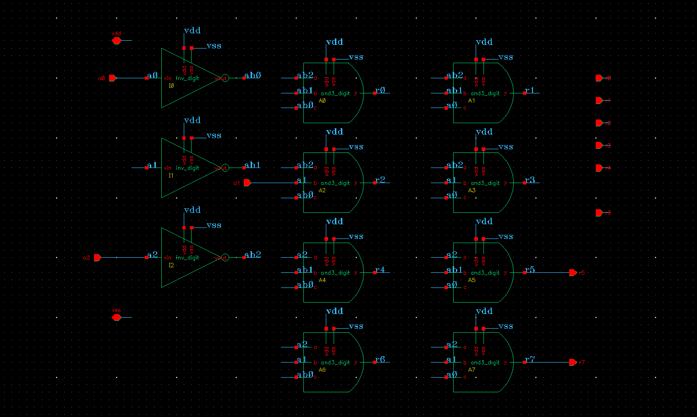

3 to 8 Decoder Schematic

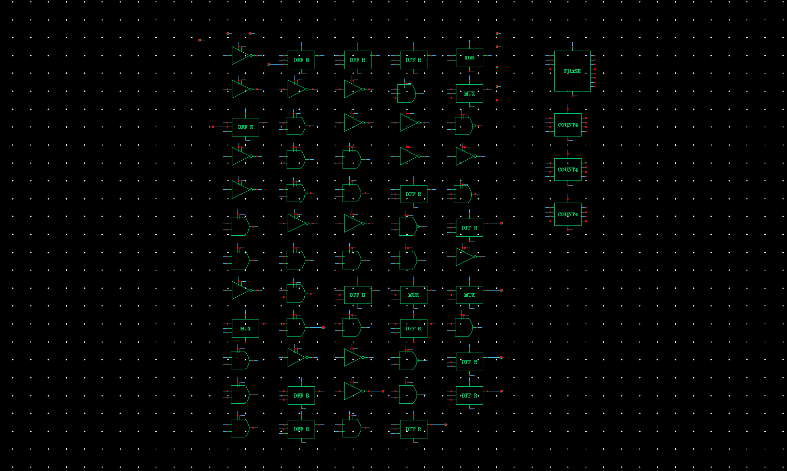

Memory Control Schematic  |  SRAM_IF_CONTROL

물리적인 SRAM 행 주소와 픽셀의 공간적 행 번호는 다르다. 픽셀 00~15의 row-major 순서를 보존하도록 저장 행과 col 선택을 조합한다.

SRAM Write Simulation

LOW에서 WE와 주소, full의 관계를 확인하였다. 두 ADC 코드가 준비될 때마다 한 행을 쓰고, 총 8개 행의 저장을 마친 뒤 full이 High가 된다.

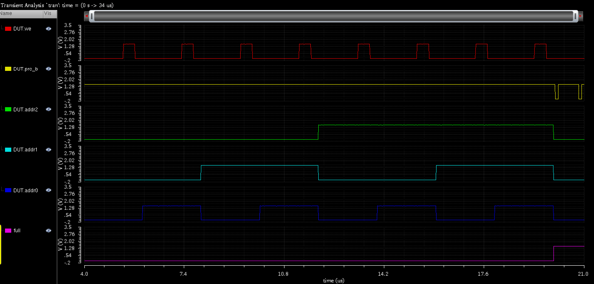

LOW 쓰기 제어 및 주소 파형

| SRAM 행 | 저장 Pixel | LOW 코드 | HIGH 코드 |
| --- | --- | --- | --- |
| 0 | 00 / 01 | 0 / 1 | 16 / 17 |
| 1 | 02 / 03 | 2 / 3 | 18 / 19 |
| 2 | 04 / 05 | 4 / 5 | 20 / 21 |
| 3 | 06 / 07 | 6 / 7 | 22 / 23 |
| 4 | 08 / 09 | 8 / 9 | 24 / 25 |
| 5 | 10 / 11 | 10 / 11 | 26 / 27 |
| 6 | 12 / 13 | 12 / 13 | 28 / 29 |
| 7 | 14 / 15 | 14 / 15 | 30 / 31 |

SRAM Read Simulation

Precharge 해제, WL 선택, Sense, Capture를 거쳐 VALID에서 최종 출력 DFF가 갱신된다. 읽기 구간은 전체 프레임 저장 이후에 시작하며, 코드의 판독은 VALID 상승 후 20 ns에서 수행한다.

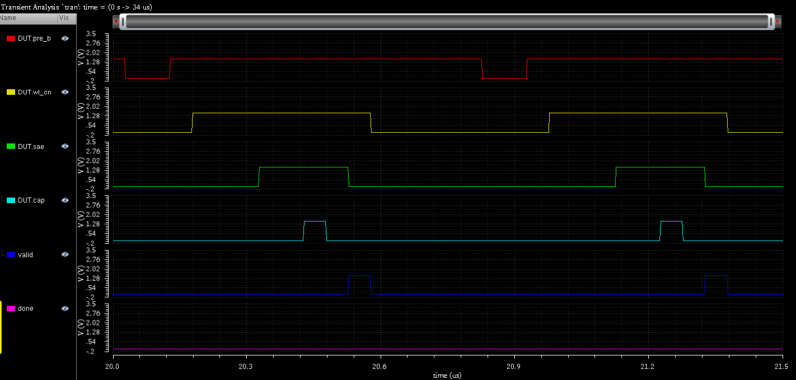

LOW 첫 읽기 구간 확대

저장된 파형에서 16회 읽기와 각 출력 유지 구간을 확인하였다. 5bit 출력은 약 800 ns 간격으로 갱신되며 마지막 단어는 시뮬레이션 종료까지 유지된다.

Output Register

SRAM의 read4~read0를 다섯 개의 실제 1.5 V DFF가 저장한다. VALID가 갱신 시점을 지정하며, 최종 Q4~Q0는 이 레지스터의 출력이다.

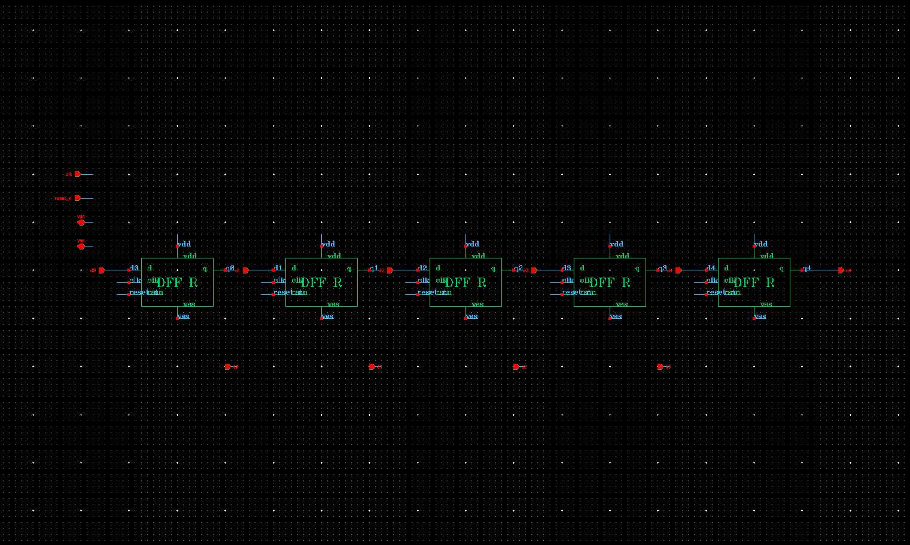

5bit Output Register Schematic

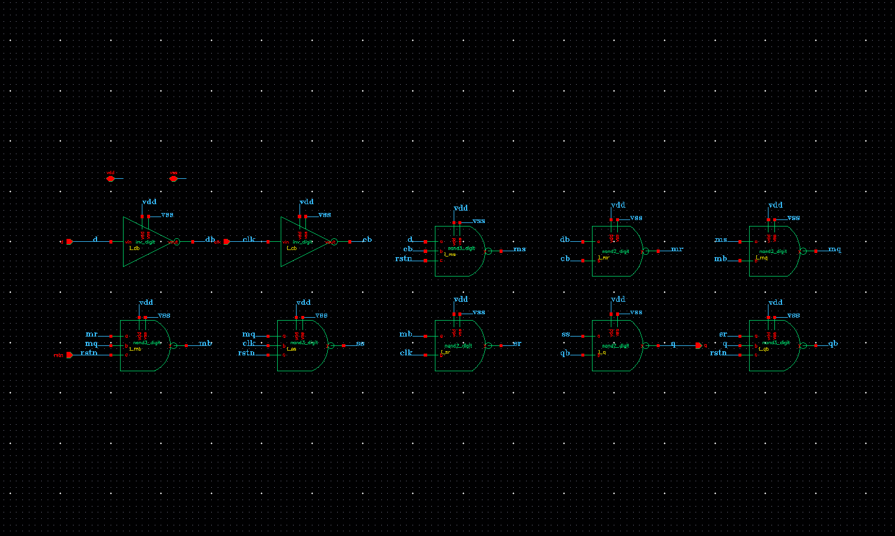

출력에 사용한 Reset DFF의 하위 Schematic

ADC의 3.3 V 코드와 최종 출력의 약 1.5 V 파형을 혼동하지 않도록 각 그림에 신호와 전압 범위를 구분하였다.

Bias 회로

저항 분압과 Buffer로 Source Follower의 바이어스, Common Mode, ADC의 hi·lo 및 SRAM Precharge 전압을 생성한다. 외부에서 개별 바이어스 전압을 별도로 인가하지 않는다.

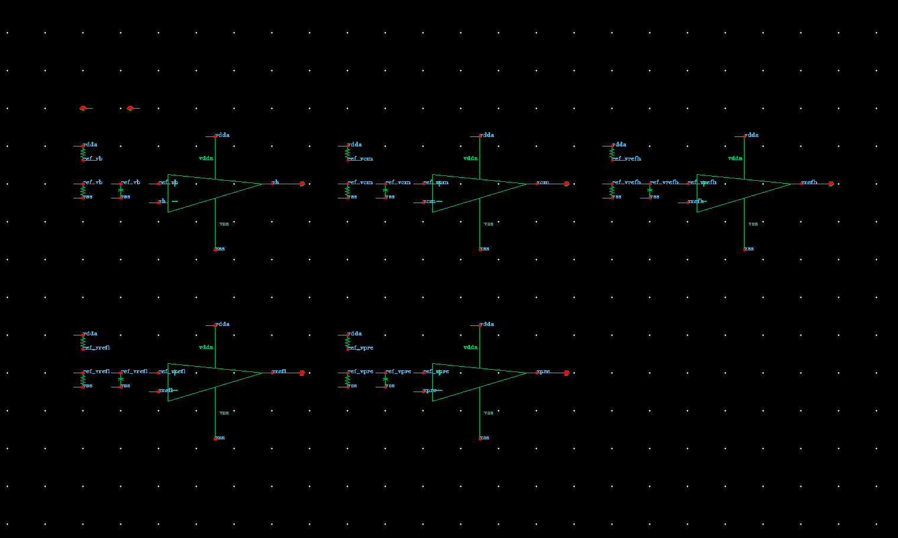

Bias Schematic

ADC 기준은 최종 검증 회로의 공통 −10 mV 보정을 반영한 상태이다. 보고서 작성 과정에서 분압 저항이나 회로의 동작 조건을 바꾸지 않았다.

Bias 측정값

아래는 LOW의 실제 바이어스 파형이다. V1은 10 μs의 순간 전압이며, 표는 1 μs 이후 저장된 전체 구간의 평균값이다. 따라서 마커의 순간값과 평균값은 서로 같을 필요가 없다.

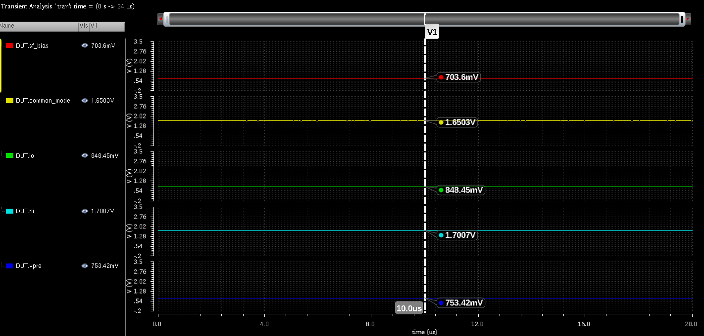

LOW Bias 파형  |  V1 10 μs

| 노드 | LOW 평균 V | HIGH 평균 V |
| --- | --- | --- |
| sf_bias | 0.697773 | 0.697584 |
| common_mode | 1.644512 | 1.644067 |
| lo | 0.842633 | 0.842405 |
| hi | 1.694851 | 1.694386 |
| vpre | 0.747595 | 0.747393 |

표는 vss 기준이며 ViVA 마커는 저장된 노드 전압을 직접 표시한다. 두 프레임의 차이는 입력과 내부 부하의 동작에 따른 것이다.

PLL

외부 20 MHz 클록을 기준으로 PFD, Charge Pump, Loop Filter, VCO 및 ÷2 피드백 경로를 구성하였다. 피드백으로 생성한 약 40 MHz의 fast를 Timing 회로에 공급한다.

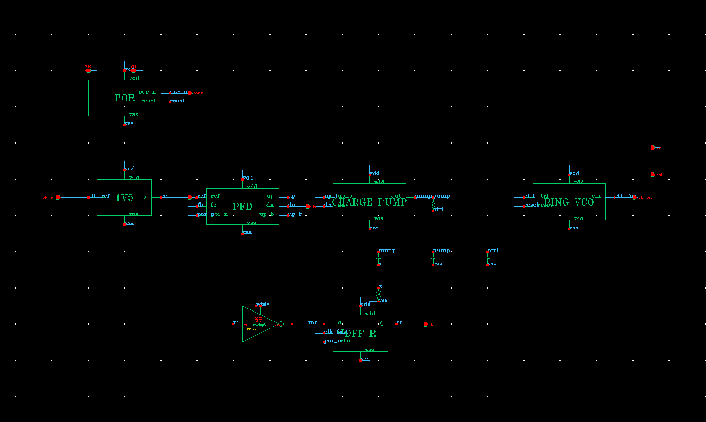

PLL Schematic

단순 Counter나 Divider만을 PLL로 표현한 것이 아니다. 다만 평균 주기와 기능 동작을 확인한 범위이며 Phase Noise, 지터 규격 및 PVT Lock Range를 검증한 결과는 아니다.

기준 클록과 내부 클록

외부 clk의 주기는 50 ns이며 내부 fast는 약 25 ns이다. ready는 초기화 대기를 마친 뒤 Timing 동작을 허용한다.

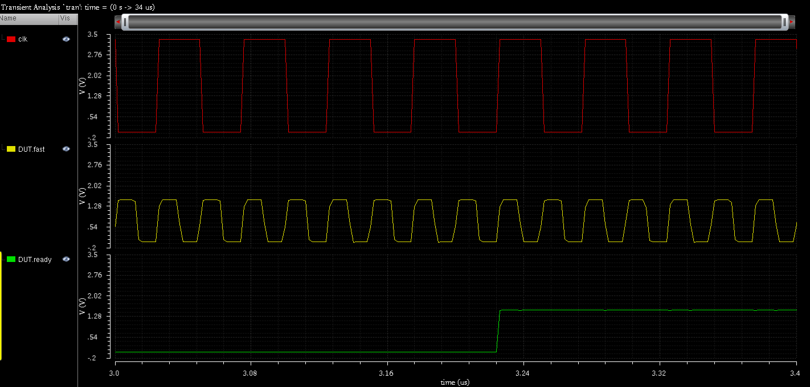

LOW 기준 클록 및 내부 fast 확대

| 프레임 | 측정 평균 주기 ns | 환산 주파수 MHz |
| --- | --- | --- |
| LOW | 25.000003 | 39.999995 |
| HIGH | 25.000050 | 39.999921 |

평균 주기는 기존 검사에서 ready 이후 2 μs가 지난 구간을 사용하였다. 위 확대 그림의 시간 구간과 평균 산출 구간은 구분한다.

Timing circuit

PLL 출력으로 Counter와 Decoder를 구동하여 Pixel Reset·Transfer, CDS Track·Clamp, ADC Sample·Capture·Amplify·Output Clock을 생성한다. 출력 Buffer와 전압 변환 회로를 거쳐 각 부하에 전달한다.

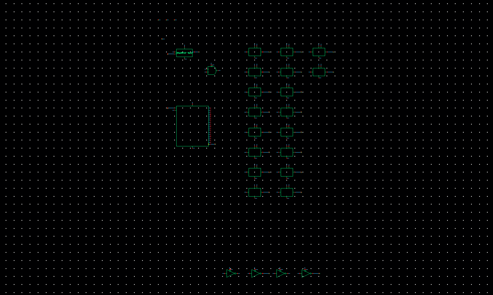

Timing Schematic

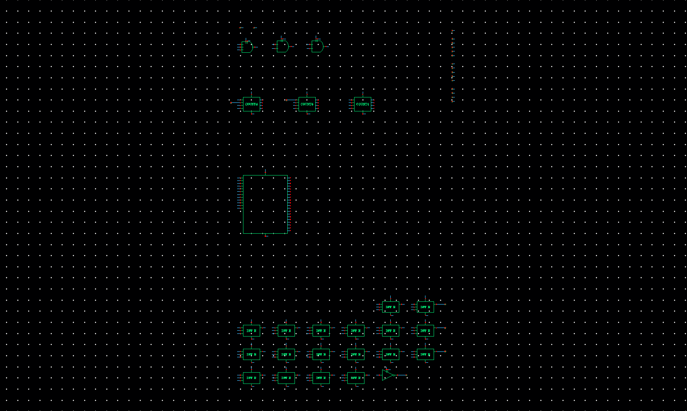

Timing Core Schematic

변환 주기의 동작 순서

한 픽셀 쌍에 2 μs를 할당한다. 아래 구간은 픽셀 쌍 선택 시작을 0 ns로 둔 설계 타이밍이며, 실제 배선과 게이트 지연은 저장된 파형에서 확인한다.

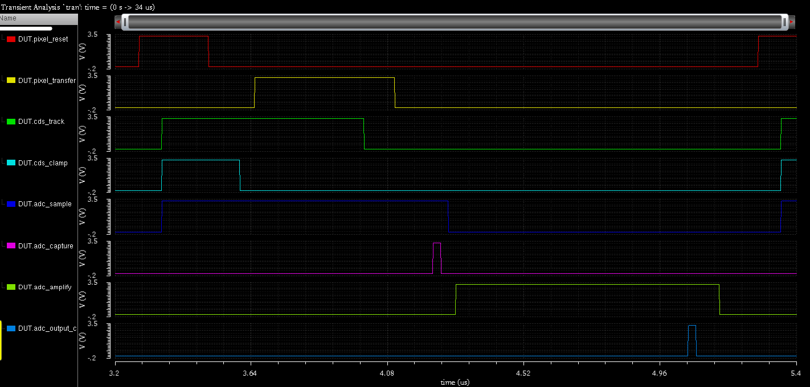

LOW 첫 픽셀 쌍의 Pixel CDS ADC 제어 신호

| 제어 | 설계 활성 구간 ns |
| --- | --- |
| Pixel Reset / Transfer | 25~250 / 400~850 |
| CDS Track / Clamp / Init | 100~750 / 100~350 / 0~50 |
| ADC Sample / Coarse capture | 100~1025 / 975~1000 |
| ADC Amplify / Output capture | 1050~1900 / 1800~1825 |
| Pixel pair select | 0~1950 |

Sample과 Amplify의 비중첩, Coarse capture 시 Sample 활성, Output capture 시 Amplify 활성 여부를 기존 전체 파형으로 검사하였다.

LOW 전체 Simulation 회로

16개의 픽셀에 0.96~1.56 V를 0.04 V 간격으로 인가하였다. LOW의 기대 출력은 코드 0~15이다. 두 Testbench는 공통 코어를 공통으로 사용한다.

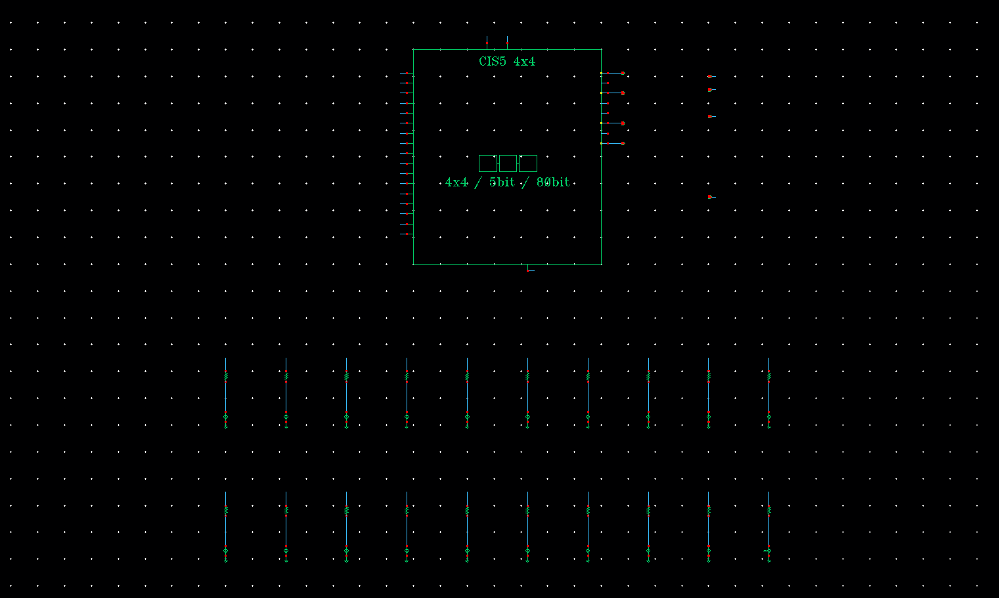

LOW Testbench Schematic

16개 픽셀 입력과 clk, vdda, vddd, vss의 총 20개 전압원 가지는 상단 네트 라벨 → 1 Ω 저항 → 전압원 → analogLib GND 형식이다. 기존 검증은 이 저항을 포함한다.

HIGH 전체 Simulation 회로

16개의 픽셀에 1.60~2.20 V를 0.04 V 간격으로 인가하였다. HIGH의 기대 출력은 코드 16~31이다. 두 Testbench는 공통 코어를 공통으로 사용한다.

HIGH Testbench Schematic

16개 픽셀 입력과 clk, vdda, vddd, vss의 총 20개 전압원 가지는 상단 네트 라벨 → 1 Ω 저항 → 전압원 → analogLib GND 형식이다. 기존 검증은 이 저항을 포함한다.

LOW 통합 Simulation

LOW의 WE, full, VALID, done과 Q4~Q0를 함께 표시하였다. 위는 저장한 실제 ViVA 캡처이고, 아래는 같은 캡처 위에 구간 설명과 논리 0·1을 추가한 버전이다.

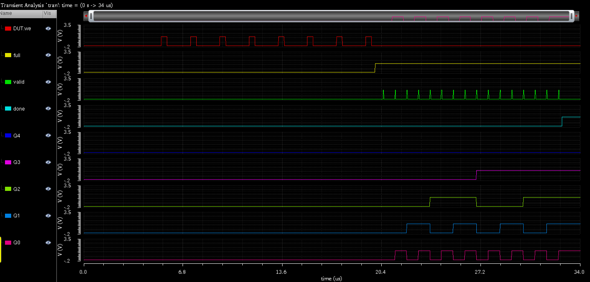

LOW 통합 파형 원본

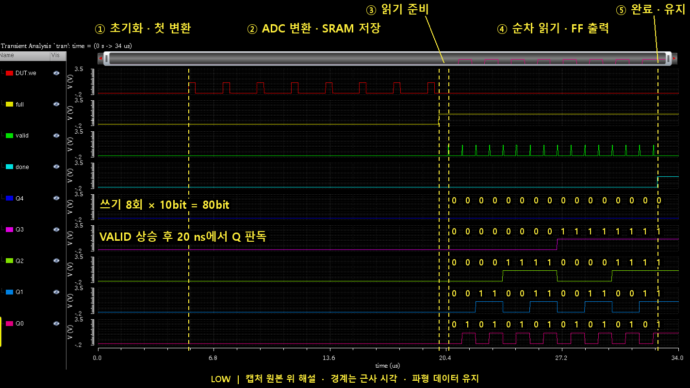

LOW 통합 파형 해설

8회 Write 후 16개 단어를 순차 출력한다. 마지막 값 01111는 done 이후에도 유지된다. 설명의 구간 경계는 저장 데이터에서 얻은 근사 시각이다.

HIGH 통합 Simulation

HIGH의 WE, full, VALID, done과 Q4~Q0를 함께 표시하였다. 위는 저장한 실제 ViVA 캡처이고, 아래는 같은 캡처 위에 구간 설명과 논리 0·1을 추가한 버전이다.

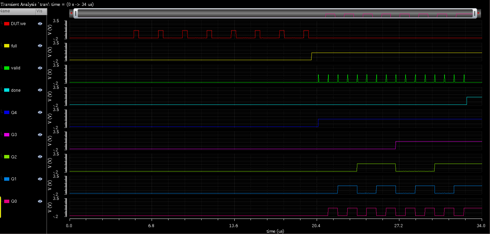

HIGH 통합 파형 원본

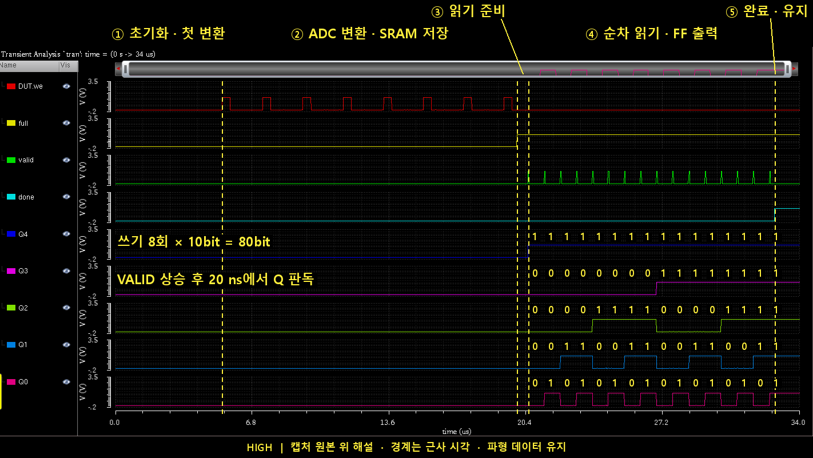

HIGH 통합 파형 해설

8회 Write 후 16개 단어를 순차 출력한다. 마지막 값 11111는 done 이후에도 유지된다. 설명의 구간 경계는 저장 데이터에서 얻은 근사 시각이다.

LOW와 HIGH 최종 출력 비교

16개 픽셀을 두 번의 독립된 입력 프레임으로 시험하여 총 32개 입력 수준을 확인하였다. 모든 파형의 전압축은 −0.2~3.5 V로 통일하였다. LOW·HIGH 비교 그림은 같은 시간축을 사용하며, 세부 동작을 확대한 그림은 본문에 해당 구간을 명시하였다.

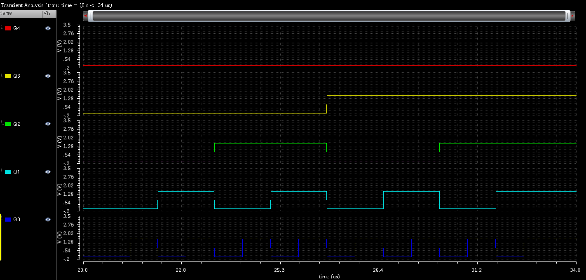

LOW 최종 Q4~Q0  |  00000 → 01111

HIGH 최종 Q4~Q0  |  10000 → 11111

두 프레임의 첫 읽기는 약 20.527 μs, 마지막 읽기는 약 32.527 μs이다. 코드 판독은 각 VALID 상승 후 20 ns에 수행하였다.

출력 전압의 실제 측정

HIGH의 마지막 두 단어는 11110과 11111이다. V1 31.747 μs와 V2 32.547 μs에서 측정하여 Q0의 전환과 나머지 비트의 유지 상태를 확인하였다.

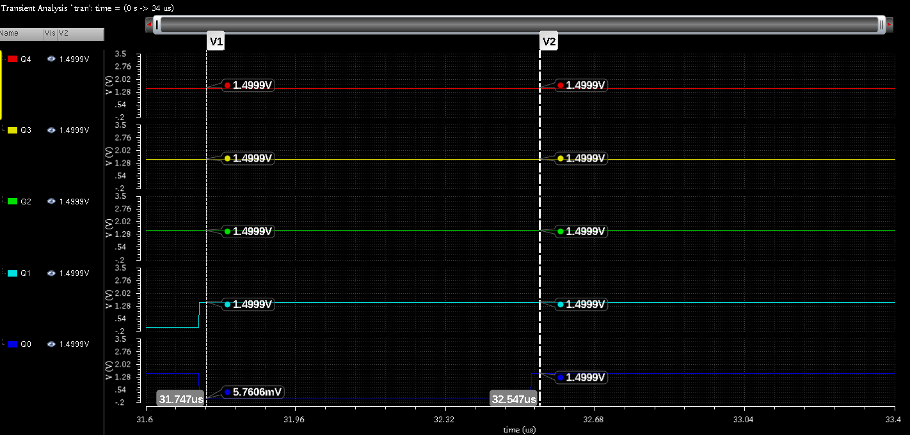

HIGH 최종 출력과 실제 ViVA V 마커

V 마커와 연결된 전압값에만 Bold 13을 적용하였다. 왼쪽 신호 목록과 축 글꼴은 ViVA 기본 설정을 유지하였다. IC616에서는 이 측정값의 글꼴이 V 마커 글꼴을 따르는 동작이 확인되어 두 항목을 같은 크기로 설정하였다.

32개 입력과 ADC SRAM 최종 코드

동일한 Pixel 번호에 LOW와 HIGH 입력을 각각 적용한 결과를 비교하였다. 각 열의 ADC와 최종 Q가 같은 코드를 나타내며, 전체 32개 이산 입력점이 기대 코드와 일치하였다.

| Pixel | LOW 입력 V | ADC / Q | HIGH 입력 V | ADC / Q |
| --- | --- | --- | --- | --- |
| 00 | 0.96 | 00000 / 00000 | 1.60 | 10000 / 10000 |
| 01 | 1.00 | 00001 / 00001 | 1.64 | 10001 / 10001 |
| 02 | 1.04 | 00010 / 00010 | 1.68 | 10010 / 10010 |
| 03 | 1.08 | 00011 / 00011 | 1.72 | 10011 / 10011 |
| 04 | 1.12 | 00100 / 00100 | 1.76 | 10100 / 10100 |
| 05 | 1.16 | 00101 / 00101 | 1.80 | 10101 / 10101 |
| 06 | 1.20 | 00110 / 00110 | 1.84 | 10110 / 10110 |
| 07 | 1.24 | 00111 / 00111 | 1.88 | 10111 / 10111 |
| 08 | 1.28 | 01000 / 01000 | 1.92 | 11000 / 11000 |
| 09 | 1.32 | 01001 / 01001 | 1.96 | 11001 / 11001 |
| 10 | 1.36 | 01010 / 01010 | 2.00 | 11010 / 11010 |
| 11 | 1.40 | 01011 / 01011 | 2.04 | 11011 / 11011 |
| 12 | 1.44 | 01100 / 01100 | 2.08 | 11100 / 11100 |
| 13 | 1.48 | 01101 / 01101 | 2.12 | 11101 / 11101 |
| 14 | 1.52 | 01110 / 01110 | 2.16 | 11110 / 11110 |
| 15 | 1.56 | 01111 / 01111 | 2.20 | 11111 / 11111 |

Q4가 최상위 비트이고 Q0가 최하위 비트이다. 코드 0~31의 이 시험 결과만으로 입력 전체 구간의 선형성이나 잡음 성능을 단정하지 않았다.

전체 검증 결과

본 보고서의 파형은 2026년 11월 10일 저장된 LOW·HIGH 명목 결과를 다시 열어 캡처하였다. 보고서 작성을 위한 새 Transient 시뮬레이션은 수행하지 않았다.

| 검사 항목 | LOW | HIGH |
| --- | --- | --- |
| ADC 변환 | 16 / 16 | 16 / 16 |
| SRAM 행 쓰기 | 8 / 8 | 8 / 8 |
| 최종 5bit 읽기 | 16 / 16 | 16 / 16 |
| 저장 노드 유지 | 80 / 80 | 80 / 80 |
| Pixel 및 WL one hot | 통과 | 통과 |
| Sample Amplify 비중첩 | 통과 | 통과 |
| Write Precharge 비중첩 | 통과 | 통과 |
| full 이후 읽기 및 done | 통과 | 통과 |

명목 조건은 Spectre APS, TT 27 °C, reltol=10⁻³, maxstep=5 ns, 저장 간격=2 ns, 종료=34 μs이다. 더 엄격한 기존 LOW·HIGH 재검증에서도 같은 기능 항목을 통과하였다.

재검증 조건은 reltol=7.5×10⁻⁴, maxstep=2 ns, 종료=33.4 μs이다. 그보다 강한 수치 조건의 시간 제한 종료 기록을 통과로 포함하지 않았다.

물리 구현 개요

칩 레이아웃은 기능 검증용 회로와 구분하여 설계하였다. 레이아웃용 하위 회로에는 rnppoly 저항과 MIM 커패시터를 사용한다. 아래는 현재 저장된 전체 Layout의 실제 캡처이다.

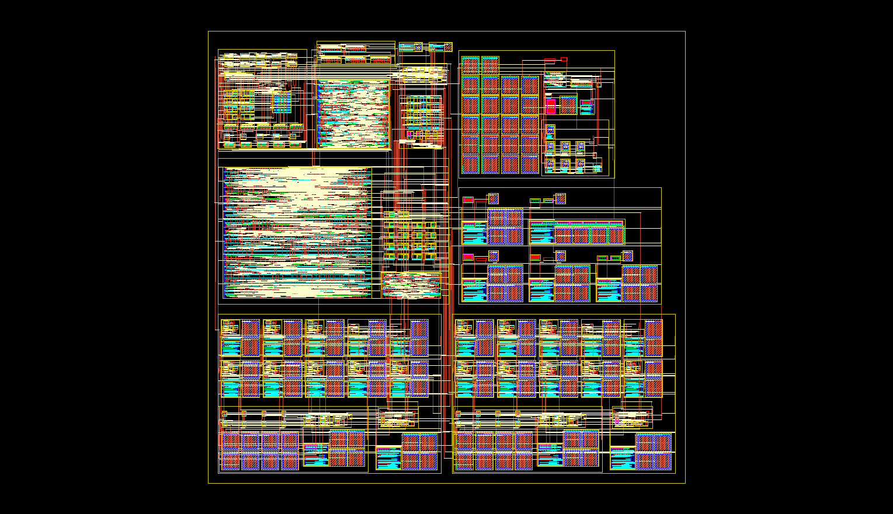

전체 Layout  |  724 × 687 μm

기존 검증 기록은 native schematic LVS CORRECT, ERC 0, Antenna 0이다. Density 제외 DRC는 Pad 관련 8건이며, 전체 DRC 20건에는 Density 12건이 포함된다.

패드·밀도 관련 DRC 항목과 PEX 검증이 남아 있다. 기능 검증에는 analogLib의 저항·커패시터 모델을 사용하였다.

## 결과

Discussion

4×4 Pixel Array, 두 개의 3bit+2bit Pipeline ADC, 80bit SRAM과 다섯 개의 출력 DFF를 연결하였다. 두 픽셀을 동시에 변환해 10bit씩 저장하고, 전체 프레임 저장 후 5bit씩 픽셀 순서대로 읽는 경로를 확인하였다.

16개 픽셀로 32개 입력 전압 수준을 시험하기 위해 LOW와 HIGH를 나누었다. LOW는 0.96~1.56 V에서 00000~01111, HIGH는 1.60~2.20 V에서 10000~11111을 출력하였다. 두 프레임 모두 입력 간격은 0.04 V이다.

검증 범위는 TT 27 °C의 프레임 단위 기능이다. PVT, Noise, Mismatch, PEX, 연속 프레임 재시작, 조밀한 DC 전달 특성 및 SRAM 소자의 스트레스 신뢰성은 추가 검증이 필요하다.
